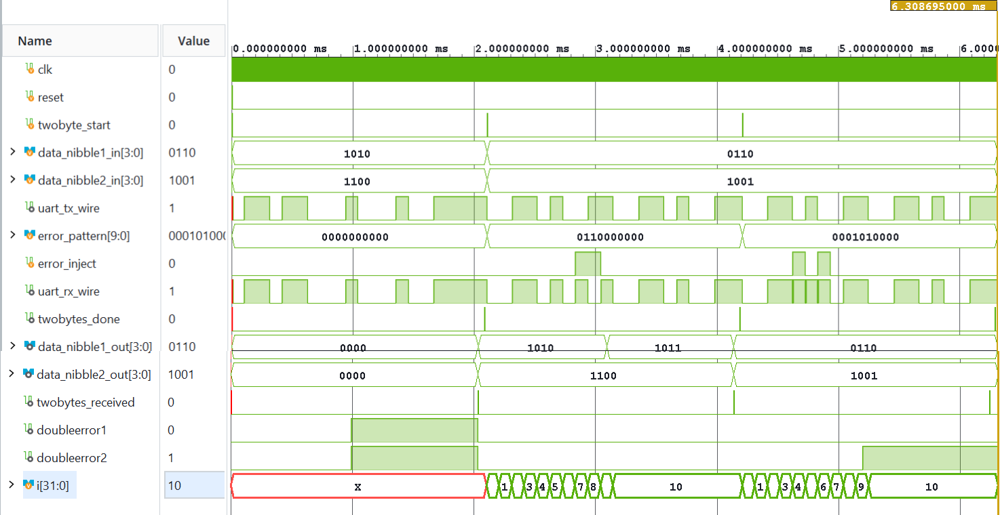

# SECDED (8,4) Interleaved UART Transceiver

A modular Verilog UART transceiver with extended Hamming `(8,4)` SECDED forward error correction and `2x8`-bit bit-interleaving, verified in AMD Vivado.

## Motivation
A small project to learn how error-correcting codes work in hardware. In streaming serial links, retransmission isn't always practical, so the receiver corrects what it can and flags what it can't.
- **Why SECDED + Interleaving:** Standard `(8,4)` SECDED corrects 1-bit errors and detects 2-bit errors per codeword, which breaks down under adjacent burst noise. Alternating bits from two codewords across two transmitted bytes splits any 2-bit adjacent burst into one single-bit error per codeword, allowing both decoders to recover the original data on the fly.
- **Error Flagging:** When two errors land in the same codeword, the decoder raises `doubleerror1` or `doubleerror2` instead of silently outputting corrupted data, allowing a downstream signal processor or state estimator to gate bad samples.

## Architecture
Configurable via `top.v` parameters (`CLK_freq = 100 MHz`, `BaudRate = 9600`), using `16x` oversampling (`baud_counter.v`) with mid-bit sampling on receive.

- **TX Path:** Two 4-bit nibbles → `SECDED_Encoder` (x2) → `interleaver_8bitsx2` → `twobytes_tx_fsm` → `uart_tx`
- **RX Path:** `uart_rx` → `twobytes_rx_fsm` → `deinterleaver_16bits_tohalf` → `SECDED_Decoder` (x2)
- **Codeword Layout (`[7:0]`):** `{D4, D3, D2, P3, D1, P2, P1, P0}`, where `P1`–`P3` are Hamming parity bits and `P0` is the overall parity bit.
- **Output Registration:** Decoded outputs and `doubleerror` flags are captured on `clk` when `twobytes_received` pulses, preventing mid-frame glitches.

## Verification (`tb_top.v`)
End-to-end loopback simulation in Vivado with channel errors XOR-injected onto `uart_rx_wire` using a 10-bit frame mask `{Stop, Bit7..Bit0, Start}` synchronized to `tickx16`:

1. **Clean Channel/No Error (`0000000000`):** Verified full 2-byte transfer (`1010`, `1100`) with `doubleerror1 = 0`, `doubleerror2 = 0`.
2. **2-Bit Adjacent Burst Error (`0110000000`):** Flipped Data Bits 6 and 7 in Byte 1; de-interleaving separated the burst across both codewords and both decoders recovered the original nibbles (`0110`, `1001`) with `doubleerror = 0`.
3. **2-Bit Same-Codeword Error (`0101000000`):** Sent `1101` and `0011` while flipping two bits in codeword 2 (Data Bits 7 and 5 in Byte 1); verified codeword 1 decoded cleanly (`1101`, `doubleerror1 = 0`) while codeword 2 flagged the uncorrectable double error (`0010`, `doubleerror2 = 1`).

